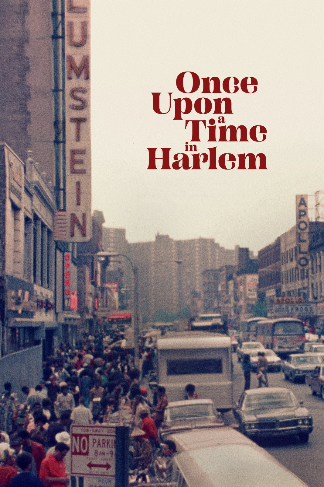
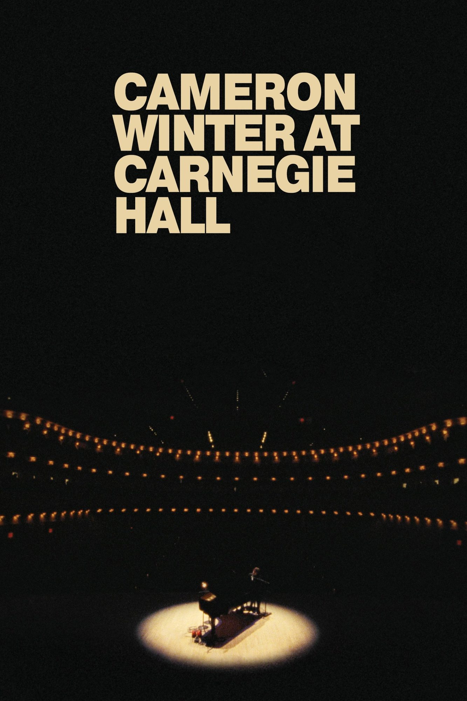
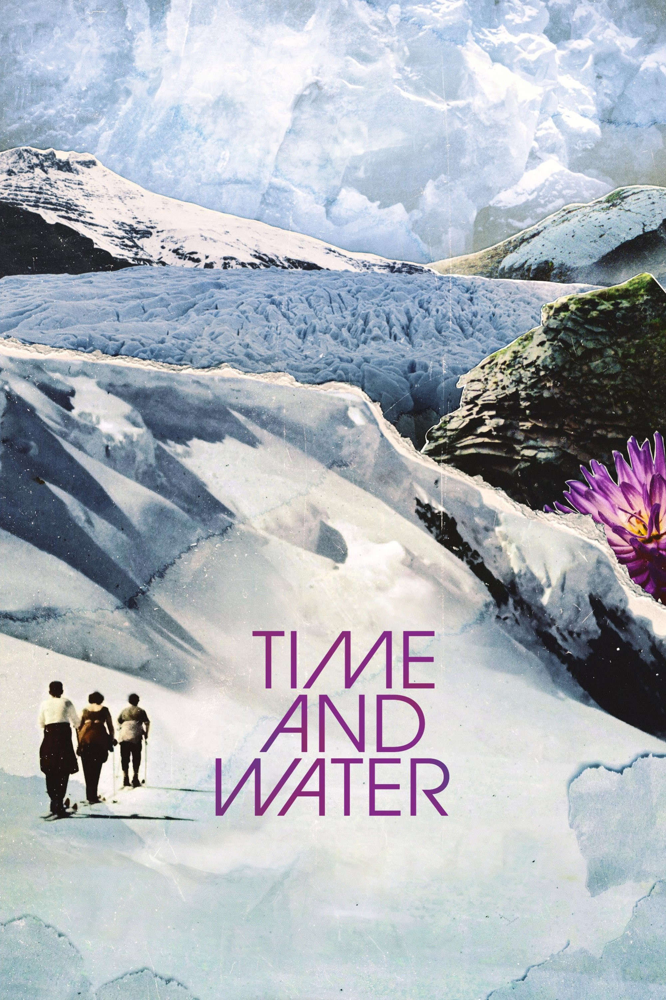
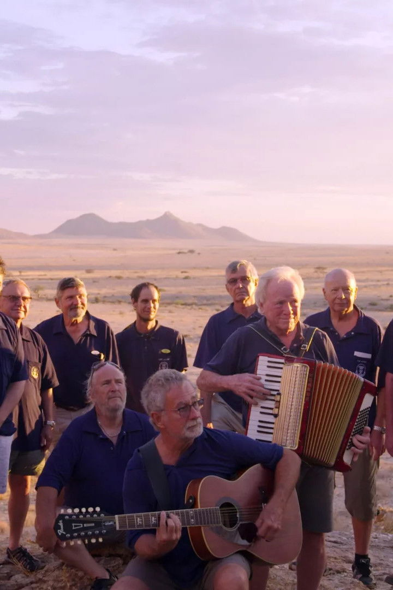
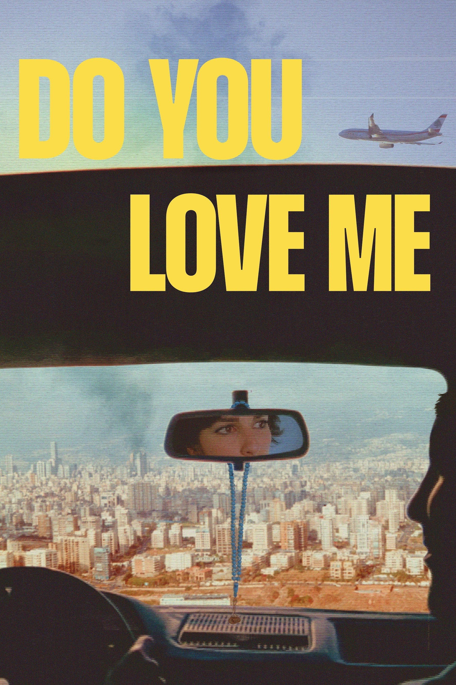
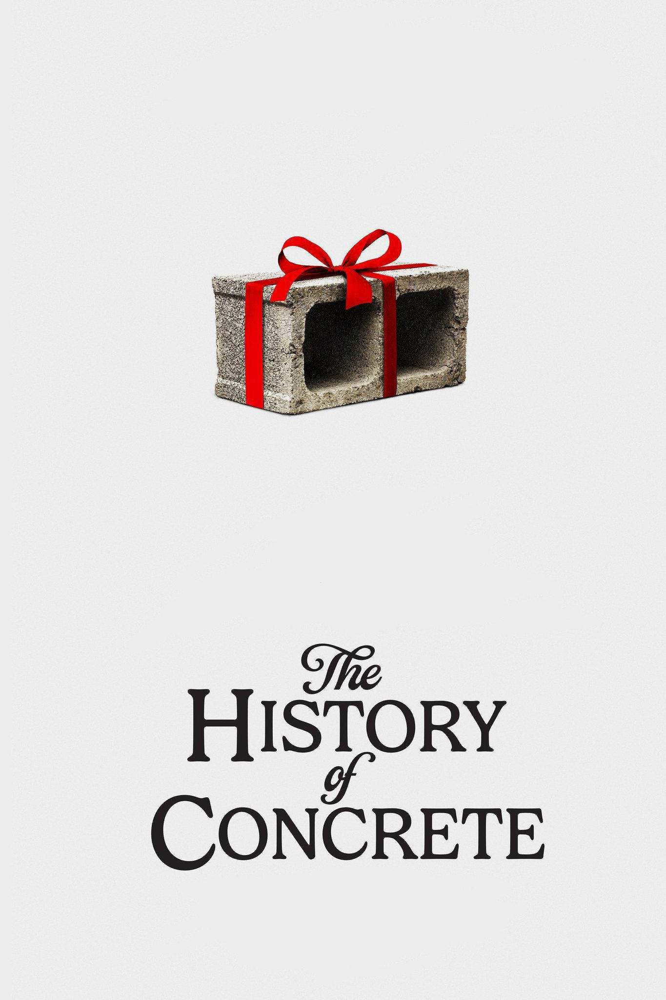
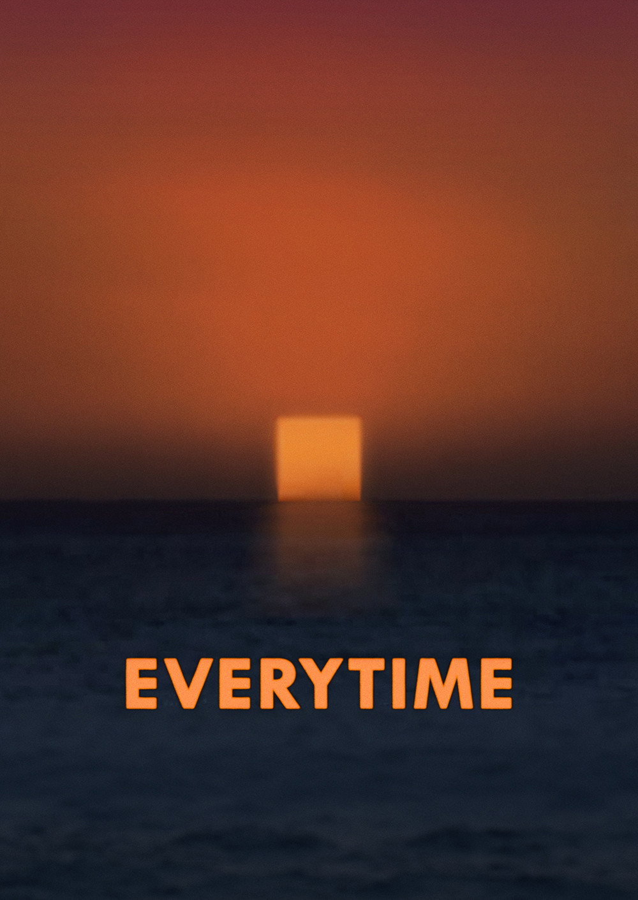
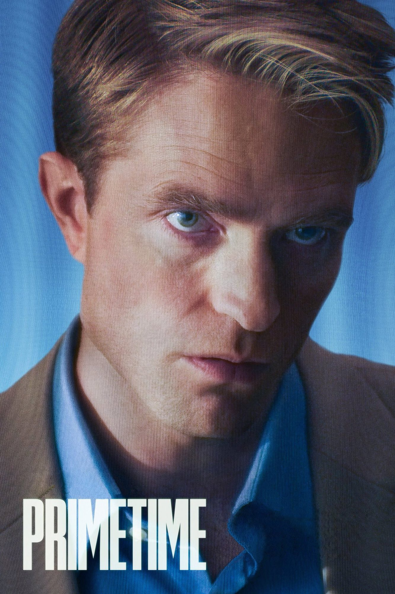
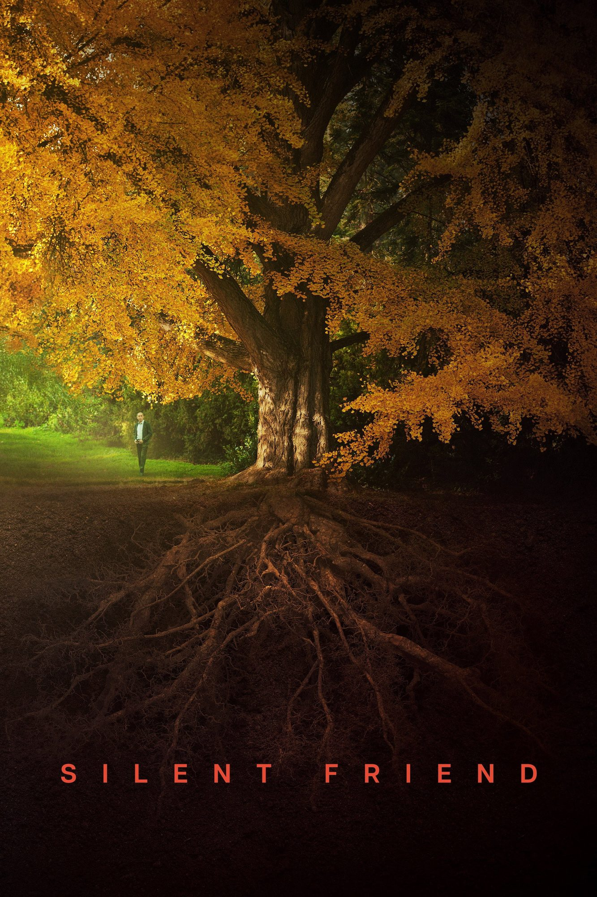

# [All of a Sudden](https://letterboxd.com/film/all-of-a-sudden-2026/)

Hamaguchi returns with his stage-play-disguised-as-a-film conversational epic. It's about the paradox of running a humane care home under capitalism. It's about unexpected friendships. It's about making a play (of course). It's about facing your mortality. It's about work life balance. It's about how we take care of each other. Halfway through the movie there is a half-hour long lecture about capitalism. It's 200 minutes of nonstop dialog. No doubt my favorite one at BIFF. But I knew that before I'd seen it.

# [Once upon a time in Harlem](https://letterboxd.com/film/once-upon-a-time-in-harlem/)

A surprise find for me because I'd just seen William Reeve's [Symbiopsychotaxiplasm](https://letterboxd.com/film/symbiopsychotaxiplasm-take-one/). A lively, thorough, and heart-warming account of a dinner party with the leading figures of the Harlem Renaissance hosted by Duke Ellington 50 years later. 

# [Cameron Winter at Carnegie Hall](https://letterboxd.com/film/cameron-winter-at-carnegie-hall/)

One of the best concert movies with incredible cinematography and fun flairs.

# [Time and Water](https://letterboxd.com/film/time-and-water-2026/)

Seems to be a more personal account of the Ok glacier and the author's relationship with it than the book. Half the movie focuses on the retreating glaciers and climate change. The other half is an incredibly tender tribute to the four generations of family living along with the glaciers. It feels easier to grieve over family members when they die of natural causes. How do you grieve over a glaicer when you killed it? 

# [Meanwhile in Namibia](https://letterboxd.com/film/meanwhile-in-namibia/)

An insane account of some of the most ridicously and unironically racist bullshit done by the German government in Namibia. You'd think it was shot 50 years ago.

# [Do You Love Me](https://letterboxd.com/film/do-you-love-me-2025/)

A very stylish supercut of archival and film footages shot over many decades in Beirut.

# [The History of Concrete](https://letterboxd.com/film/the-history-of-concrete/)

John Wilson tricked his producers to make this documentary about concrete and we were tricked to watch a very long episode of How to.

# [Rose](https://letterboxd.com/film/rose-2026/)

A German Mulan that is incredibly real and visceral.
	
# [Barbara Forever](https://letterboxd.com/film/barbara-forever/)

A very tenderly made documentary about an insanely cool person.

# [Everytime](https://letterboxd.com/film/everytime/)

I was too tired when I saw this. Some of the choices made later into the film are very imaginative and mysterious. I didn't get it but that's on me.	

# [Primetime](https://letterboxd.com/film/primetime-2026/)

Overhyped bullshit. Here for Phoebe Bridgers and the cinematography.

# [Silent Friend](https://letterboxd.com/film/silent-friend/)

Three stories about (mostly?) friendships taking place around a huge Gingko tree in Germany. The second story about the friendship between a weird guy and a pot of door-opening flower is cute. But in the end the story doesn't tie together at all. Was the Gingko tree looking for a friend this entire time?
