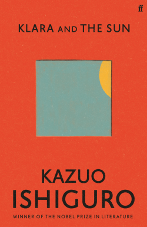
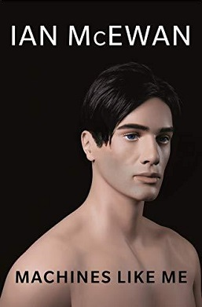

# [Klara and the Sun](https://www.goodreads.com/book/show/54120408)


A fully conscientious robot with the mind of a child and yet superhuman abilities being sold as an Artificial Friend for children. I love that you could not really tell what Ishiguro intended the message of the story to be. Most of the story revolves around how a cognitively unevenly (or compared to humans) developed robot sees and learns about the world. The choice that the AFs are fully equipped top-of-the-spec shells for near zero understanding of the human world makes it less a story about robots but one about how humans always end up disappointing each other and how we always eventually grow up and move on. All Klara had left in the end was the benevolent Sun. 

> All Klara had left in the end was the benevolent Sun.
	
# [Machines like Me](https://www.goodreads.com/book/show/42086795)


Another robot sold as a companion. This time the story puts more focus on alternative history in the late 90s England. As part of two dozens of robots newly developed and sold to humans, Adam, like Klara, is learning about the human world fresh but is already equipped with incomprehensible abilities. The speed at which he grows in cognition is astonishing. He learns about the world and combs through his thought in the background when he's charging. Stock market is too easy for him. He churns out haikus to express his love to his owner. He jokes about breaking his owner’s arm if he tries to shut him off. Yet he is loyal. But to what? At the beginning, it seems like he is following orders and just being a housechore robot. However, cracks start to show up. He follows orders but he has his own agenda too. Eventually the gap between his and his owners' flawed morals grows so huge that they become incomprehesible to each other so he betrays them and they betray him in turn. 
