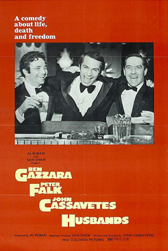
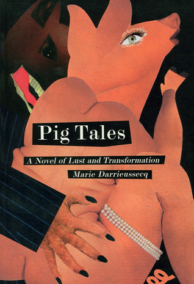

# [Husbands](https://letterboxd.com/film/husbands/)



I saw Husbands by John Cassavetes at Bergen Filmklubb. Excruciating is the only word I have to describe the experience. You follow three middle-aged white collar workers in New York getting shitfaced after attending a friend’s funeral. Recognizing their mortality, they decide to go on the ultimate bro’s trip. Hungover basketball. Getting shitfaced and forcing old people to sing for them. Beating up the wife and terrorizing the family. Trying to throw up but your bro is talking too much. Flying to London on a whim with no luggage. Trying to hook up but all you are doing is either crying in bed together or attempting (roleplaying?) rape. The ultimate frat bro movie but with middle-aged guys.

Related reading: [What Makes Men in Groups Behave so Badly? (NYT)](https://www.nytimes.com/2026/10/20/opinion/cornell-chi-phi-group-chat-bro-code.html)

# [Pig tales](https://www.goodreads.com/book/show/767124)



A thriving Parisian woman working at a cosmetics store slowly metamorphosing into a pig. I thought the story would ease into the transformation so I was floored when it happened way before halfway of the book. Everything that happened since then can only be described as a relentless nightmare. The closest analogies I can think of are The Onion’s old YouTube series [Porkin' Across America](https://youtu.be/PwQns6vGfj4?si=SqcbITEpVpp_7hF5), the Vegetarian, and Eraserhead. I was pleasantly surprised this was first published in 1996.
